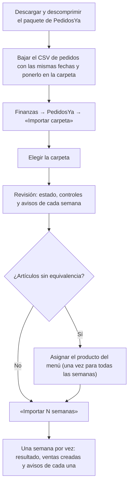

# Guía de Importación de Carpetas de PedidosYa — Ohana POS

Documento técnico y operativo para la carga de las carpetas de liquidación (`payoutArchive_*`) en el módulo de
**Finanzas** de Ohana POS.

> Revisada el 2026-11-03 contra el código (rama `fix/importar-carpeta-pedidosya`): el CSV no viene en el paquete, una
> semana sin CSV se puede completar después, todos los avisos se ven, una semana borrada se puede volver a importar y
> los documentos entran en el respaldo diario.

---

## 1. Qué se descarga de PedidosYa

### 1.1 El paquete de liquidaciones

El portal de PedidosYa (*Portal de Partner*) entrega un archivo comprimido con el formato
`payoutArchive_PY_BO_AAAAMMDD_to_AAAAMMDD.zip`. Las fechas del nombre son las de **pago**, no las de venta: el paquete
de octubre (`20261001_to_20261101`) trae las semanas **del 21/09 al 25/10**, porque la del 21–27/09 se pagó el 01/10.

Al descomprimirlo, hay tres archivos por semana, con su **número de liquidación** (por ejemplo, `7800712391`):

```text
payoutArchive_PY_BO_20261001_to_20261101/
├── account_statement_7800702619_1.pdf   <-- Estado de cuenta semana 1
├── invoice-7800702619.xls               <-- Pedidos y reclamos semana 1
├── invoice_7800702619.pdf               <-- Factura fiscal semana 1
├── account_statement_7800706345_1.pdf   <-- Estado de cuenta semana 2
├── ...
└── orderDetails.csv                     <-- NO viene en el paquete: se agrega (ver 1.2)
```

| Archivo | Tipo | Contenido y uso en el sistema |
| :--- | :---: | :--- |
| `account_statement_<N>_1.pdf` | PDF | **Estado de cuenta:** período, fecha de pago, ventas netas, comisiones, cargos por reclamos, publicidad, reintegros, IVA y total liquidado. El sistema comprueba que cuadre: `Ventas netas − Envíos − Comisiones − Cargos − Publicidad + Reintegros − Impuestos = Total liquidado`. |
| `invoice-<N>.xls` | Excel (OOXML) | **Planilla de la liquidación:** hoja *Lista de Pedidos* (número, **fecha del pedido sin hora**, método de pago, monto bruto, monto comisionable y comisión) y, si hubo reclamos, hoja *Cargos por reclamos* (pedido, fecha, hora, motivo y cargo). |
| `invoice_<N>.pdf` | PDF | **Factura fiscal** de PedidosYa al local: número, fecha de emisión, código de autorización y total (base del crédito fiscal). |

### 1.2 El CSV de pedidos (aparte)

`orderDetails.csv` se baja **por separado**, desde la sección de pedidos del portal, con las **mismas fechas que las
semanas del paquete** (para el de octubre, del 21/09 al 25/10), y se pone dentro de la carpeta. Sirve uno de todo el
período o uno por semana. Puede venir separado por comas o por punto y coma (como lo deja Excel en español).

Es lo único que trae los **artículos y la hora** de cada pedido, y por eso es necesario para **crear las ventas** en el
POS y descontar sus insumos del inventario.

> [!IMPORTANT]
> **Sin el CSV** se cargan igual los montos, los pedidos (del Excel, sin artículos ni hora), los reclamos, la factura y
> los archivos, pero **no se crean ventas**. Si después pones el CSV en la carpeta y la eliges otra vez, esas semanas
> aparecen como **«Completar»** y se completan sin duplicar nada.

---

## 2. Flujo paso a paso (Finanzas → PedidosYa)



### Paso 1: abrir la importación
1. **Finanzas** (permiso *Finanzas: Editar*) → pestaña **PedidosYa**.
2. Botón **«Importar carpeta»**.

### Paso 2: elegir la carpeta
Elige la carpeta descomprimida. El navegador pide confirmar que se suben sus archivos: **Cargar**. Los archivos que no
son de PedidosYa se ignoran y se cuentan.

### Paso 3: revisión
Para cada semana, el sistema lee los archivos sin guardar nada y muestra:

- 🟢 **Nueva:** lista para importar.
- 🔵 **Completar:** ya estaba importada, pero le faltan pedidos o el detalle de sus pedidos, y estos archivos los traen
  (por ejemplo, el CSV que faltaba). Se completa sin duplicar ventas.
- ⚪ **Ya importada:** se salta; no se cambia nada.
- 🔵 **Cargada a mano:** la misma semana, con los mismos montos, se cargó antes a mano. Se le agregan el número de
  liquidación, la fecha de pago (si le faltaba), la factura, los reclamos y los archivos; sus pedidos y ventas no se tocan.
- 🟡 **Montos distintos:** ya hay una semana en esas fechas con otro total. Para reemplazarla, elimínala en «Semanas
  del mes» y vuelve a elegir la carpeta.
- 🔴 **Se cruza / Bloqueada:** las fechas se cruzan con otra semana, o un control no cuadra (el estado de cuenta no
  suma su total, aparece un concepto que el sistema no guarda, o el Excel no coincide con el PDF en ventas, comisión o
  reclamos). Esa semana se puede cargar a mano.

Debajo de cada semana se ven **todos** sus avisos: falta la factura o el Excel, el CSV no se pudo leer, el CSV no trae
pedidos de esa semana o le faltan algunos (esos pedidos se guardan del Excel, sin artículos), la factura no coincide.

### Paso 4: equivalencias
Si el CSV trae artículos con otro nombre que en el menú del POS (por ejemplo *«Patriota Bowl»* y *«Patriota»*), se
asignan una sola vez y sirven para todas las semanas siguientes.

### Paso 5: importar
1. **«Crear o vincular las ventas en el POS»** (marcado por defecto cuando hay CSV): los pedidos entregados con artículos
   crean su venta, o se vinculan a la venta que ya existía.
2. **«Importar N semanas»**: se importa una semana por vez, con su propia transacción. Si una falla, no queda nada a
   medias de esa semana y las demás siguen.
3. El resultado dice, por semana: importada, completada o saltada; cuántas ventas se crearon o vincularon; y sus avisos
   (por ejemplo, pedidos sin detalle a los que no se les creó venta).

---

## 3. Dónde queda la información

### A. «Semanas del mes» (Finanzas → PedidosYa)
- Número de liquidación, período, fecha de pago informada por PedidosYa (la acreditación puede demorar hasta 72 h
  hábiles), ventas brutas, liquidado y lo que se queda la plataforma.
- **«Ver detalle»:** deducciones, reclamos, si faltan ventas (y si es porque los pedidos vinieron solo del Excel), y la
  **descarga** del estado de cuenta, del Excel y de la factura.
- **Eliminar una semana** libera su número de liquidación: la misma semana se puede volver a importar, y las ventas que
  ya había creado se vinculan, no se duplican.

### B. «Facturas del mes (crédito fiscal)»
Facturas de PedidosYa del mes **por fecha de emisión** (la de una semana puede caer en el mes siguiente), con cantidad,
total y crédito fiscal (13 %), y la descarga de cada PDF.

### C. Finanzas → Resumen
- **Estado de Resultados:** las ventas netas de PedidosYa se suman a las ventas del mes; comisiones, publicidad, cargos
  e IVA entran como gastos de la plataforma.
- **«Dinero que entró en el mes»:** lo que PedidosYa **depositó** en el mes según la fecha de pago, aunque la semana sea
  del mes anterior, y lo que se deposita el mes siguiente.

---

## 4. El error 500 de septiembre y lo que cambió

- **Causa:** el `orderDetails.csv` de septiembre venía separado por punto y coma y con BOM; el sistema solo aceptaba
  comas y no encontraba la columna `Nro de pedido`.
- **Ahora:**
  1. Se detecta el separador (`,`, `;` o tabulador) y se quita el BOM.
  2. Si el CSV no se puede leer, la semana se importa con los pedidos del Excel (sin artículos, sin ventas) y **el aviso
     se ve** en la revisión y en el resultado. Con el CSV corregido, la semana aparece como «Completar».
  3. Si el CSV no trae algunos pedidos de la semana, se completan con los del Excel y se avisa cuántos.
  4. Los errores de formato devuelven un mensaje claro (422), no un error 500.

---

## 5. Seguridad y respaldo de los archivos

- **Dónde se guardan:** `backend/storage/app/private/pedidosya/<número de liquidación>/` (privado, no se publica en
  internet). El número de liquidación solo admite dígitos.
- **Quién los descarga:** solo quien tiene *Finanzas* (`GET /api/finance/pedidosya-settlements/{id}/files/{tipo}`).
- **Respaldo:** el respaldo diario del VPS (`/usr/local/bin/ohana-respaldo`, que instala `deploy/vps/05-respaldos.sh`)
  copia la carpeta a Cloudflare R2 (`pedidosya/`), sin borrar en R2 lo que se elimine en el sistema. **Para activarlo
  en un servidor ya instalado, hay que volver a ejecutar `05-respaldos.sh`.**
- **En la Mac:** las carpetas `docs/payoutArchive_*` están en `.gitignore`, porque tienen datos bancarios y fiscales. No
  las subas al repositorio.
