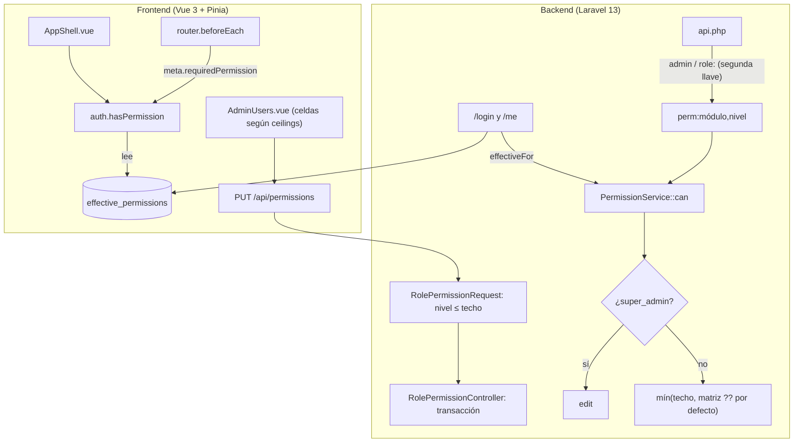

# Plan: Roles y permisos dinámicos con techo por rol (Opción C)

> **Especificación técnica y plan de cierre.** Contexto: [AGENTS.md](../AGENTS.md), [docs/BITACORA.md](BITACORA.md) y [CHANGELOG.md](../CHANGELOG.md).
> Rama de trabajo: `feat/pos-caja-arranque`.
> **Estado (2026-10-15, noche):** v2 implementada en la copia de trabajo, **sin commit** y **sin desplegar**. La
> [auditoría de la ejecución](AUDITORIA_ROLES_PERMISOS.md) confirma el núcleo del backend y encontró una regresión alta
> (cierre de sesión al volver el foco sin conexión), la dependencia de la migración para vender y la Fase 0 sin hacer;
> su sección 7 ordena las correcciones antes de fusionar. Este documento sigue siendo la especificación de referencia;
> las secciones 4 y 7 describen el estado previo a la v2. La versión inicial queda en
> [PLAN_ROLES_PERMISOS.v1.md](PLAN_ROLES_PERMISOS.v1.md).

---

## 0. Resumen

- La v1 conectó la tabla `role_permissions` al backend (`PermissionService` + middleware `perm:módulo,nivel`) y al
  frontend (store, router, menú y pantalla de permisos con columna Cocina).
- Pero los grupos `perm:` siguen dentro de los middlewares `admin` y `role:…`: **la matriz solo puede quitar acceso,
  nunca darlo más allá de lo que el rol ya tenía**, y la pantalla no lo muestra.
- Además, **"Solo lectura" no restringe** donde más importa (vender, caja, mermas, estados de pedido), hay un
  **bucle de redirección** que puede dejar a Cocina en blanco y la **migración es una dependencia dura** del despliegue.
- Propuesta v2: un **techo por rol** declarado en un solo lugar (`PermissionService`) que usan por igual la API, la
  validación y la pantalla; **permisos efectivos calculados en el backend** y enviados al frontend; y
  **GET = lectura, escritura = edición**.
- Siguiente paso: Fase 0 (higiene de commits) y Fase 1 (bloqueantes) antes de fusionar.

---

## 1. Objetivo y criterios de éxito

Que lo que el Super Admin configura en **Usuarios → Roles y permisos** sea exactamente lo que el sistema hace, con topes
que ningún dato en la base pueda saltarse.

Criterios de aceptación (todos verificables con tests o contra una copia de la base):

1. **Cada celda editable tiene efecto real:** cambiarla cambia la respuesta de la API y lo que muestra el menú. Las
   celdas sin efecto aparecen bloqueadas o como "Fijo".
2. **Ninguna fila de `role_permissions` puede dar más que el techo del rol**, aunque se haya escrito por SQL, por un
   seeder o al restaurar un respaldo.
3. **Ningún usuario queda en una pantalla en blanco:** si su rol no tiene ninguna pantalla permitida, ve "Sin acceso"
   con un botón para cerrar sesión.
4. **Un error de tipeo en una ruta** (`perm:catalgo,edit`, `perm:pos,editar`) **falla cerrado** y lo detecta un test.
5. El flujo completo de AGENTS.md (login → abrir caja → vender → cocina → anular → cerrar caja) funciona igual que
   antes con los valores por defecto.

**Fuera de alcance:** permisos por usuario individual, PIN de supervisor y las áreas que quedan fijas para
`super_admin` (Finanzas, respaldos y restauración, gestión de permisos, usuarios y auditoría).

---

## 2. Diagnóstico de partida (antes de la v1)

| Capa | Estado | Problema |
|---|---|---|
| **Matriz visual** (`AdminUsers.vue`) | Guardaba en `role_permissions`. | No tenía efecto: daba la ilusión de otorgar o quitar permisos. |
| **Middlewares** | `admin`, `super_admin` y `role:…` leían solo `user.role`. | Nada consultaba `role_permissions`. |
| **Datos** | 25 filas: admin 13, todas en `read` (incluso usuarios y auditoría); cajero 12 (sin `register_others`); cocina ninguna. | Conectar la tabla tal cual habría quitado al admin la edición de Menú, Inventario y anulaciones. |
| **Rol Cocina** | Existía en usuarios y en el POS. | No aparecía en la matriz. |
| **Store** (`auth.js`) | Recibía `permissions` en `/login` y `/me` y los descartaba. | La UI dependía de `isAdmin` / `isSuperAdmin` / `isKitchen` cableados. |

Verificado el 2026-10-15 en la base de esta Mac: las 25 filas siguen ahí, con fecha de julio, y la migración
`2026_10_15_000001` todavía no corrió.

---

## 3. Decisión: Opción C, precisada

| Opción | Descripción | Veredicto |
|---|---|---|
| **A. Conexión directa** | La matriz manda sin topes. | Descartada: un error de configuración abre Finanzas a un cajero o deja al dueño fuera de su sistema. |
| **B. Eliminar la matriz** | Roles fijos en código. | Descartada: cada ajuste requiere desarrollo y despliegue. |
| **C. Conexión con topes** | La matriz manda **dentro de un techo por rol fijado en código**. | **Seleccionada** |

La v1 implementó C a medias: el techo existe de hecho (son los middlewares `admin` y `role:…` que envuelven los grupos
`perm:`), pero no está declarado, no coincide con las listas `KITCHEN_BLOCKED` / `CASHIER_BLOCKED` y la pantalla no lo
conoce. La v2 lo hace explícito:

```
nivel_efectivo(usuario, módulo) =
    si es super_admin  → edit
    si no              → mín( techo[rol][módulo],
                              matriz[rol][módulo] ?? por_defecto[rol][módulo] )

puede(usuario, módulo, requerido) = nivel_efectivo ≥ requerido        (none < read < edit)
```

- **Techo:** constante en `PermissionService`. Es el máximo que el rol puede tener; `none` = celda con candado.
- **Matriz:** lo que configura el Super Admin. Solo recorta por debajo del techo.
- **Por defecto:** lo que se aplica si falta la fila (reemplaza al `fallback()` actual). Coincide con los valores de la
  migración.
- Los middlewares `admin`, `super_admin` y `role:…` **se mantienen** como segunda llave; un test comprueba que
  coinciden con el techo.

---

## 4. Hallazgos de la revisión (2026-10-15)

Las líneas citadas son de la copia de trabajo a esta fecha.

### 4.1 Prioridad alta — bloquean la fusión a `main`

| # | Hallazgo | Evidencia | Consecuencia |
|---|---|---|---|
| A1 | **La matriz no puede ampliar, y la pantalla no lo dice.** Los grupos `perm:` están anidados en `admin` (catálogo, inventario, reportes, CRM, anulaciones) o en `role:super_admin,admin,cashier` (ventas, caja). | `routes/api.php` L47–94 y L97–117. `restrictions()` solo bloquea `users`, `audit` y `finance` al cajero. | El Super Admin puede dar al cajero "Edición" en Menú o Inventario: se guarda, el menú muestra el enlace (las rutas `/menu` e `/inventario` ya no tienen `adminOnly`) y la API responde 403. Es la misma "falsa ilusión" que la v1 quería eliminar. Igual para Cocina en catálogo, inventario, anulaciones y CRM. |
| A2 | **"Solo lectura" permite operar.** Rutas que escriben están protegidas con `read`. | `POST /sales/sync` → `perm:pos,read` (L99–100). Abrir y cerrar turno, movimientos y mermas → `perm:register_self,read` (L105–116). `PATCH` de estado en la cola y el KDS → `perm:delivery_ops,read` (L120–131). | Poner al cajero en "Solo lectura" de Ventas no le impide vender; un admin en "Solo lectura" de Caja puede abrir y cerrar turnos. Y al revés: en Inventario "lectura" no da nada útil, porque los `GET` de insumos están abiertos a cualquier usuario autenticado (L42) y los de conteos, reorden y movimientos exigen `edit` (L63–79): la pantalla abre y sus llamadas fallan. |
| A3 | **Bucle de redirección.** El guard redirige a pantallas que también pueden estar prohibidas. | `router/index.js` L53–63: Cocina sin permiso → `/delivery`; el resto → `/pos`, `/delivery` o `/turno`, sin comprobar este último. | Cocina con `delivery_ops = none` (la pantalla lo permite) queda redirigida a `/delivery` sin fin → pantalla en blanco. Lo mismo un cajero con Ventas, Delivery y Caja en `none`. |
| A4 | **La migración es dependencia dura y sobrescribe.** | Base de esta Mac: admin con `read` en todo. `down()` solo borra las filas de cocina (L90–93 de la migración). | Si el código llega a producción y la migración no corre (o falla), el admin pierde Menú, Inventario, CRM, anulaciones y Control diario. Además reemplaza lo que el dueño haya configurado en la matriz de producción, que puede no ser igual a la local. |

### 4.2 Prioridad media

| # | Hallazgo | Evidencia | Corrección |
|---|---|---|---|
| M1 | **Los topes se aplican solo al guardar, no al decidir.** `can()` no consulta `KITCHEN_BLOCKED` / `CASHIER_BLOCKED`. Hoy no es explotable porque los middlewares de rol coinciden, pero el día que se quite un `admin` de un grupo, una fila escrita por SQL o traída por un respaldo restaurado los salta. | `PermissionService::can()` L55; solo `RolePermissionRequest` usa las listas. | Aplicar el techo dentro de `can()` (6.1). |
| M2 | **Nivel desconocido = acceso abierto.** Con `LEVEL_VALUES[$required] ?? 0`, una ruta `perm:catalog,editar` deja pasar cualquier fila, incluso `none`. En el frontend el mismo caso cae a `read` (`?? 1`): los dos lados no coinciden. | `PermissionService.php` L107; `auth.js` L27. | Excepción ante módulo o nivel desconocido + test que recorre todas las rutas. |
| M3 | **Lógica duplicada en tres lugares:** `fallback()` del backend, `fallbackPermission()` en `auth.js` y la lista de restricciones fija en `AdminUsers.vue`. Se desincronizarán. | `auth.js` L36; `AdminUsers.vue` L367. | El backend calcula y envía los permisos efectivos; el frontend solo los lee. |
| M4 | **Tres módulos no controlan nada:** `crm_read` (los `GET` de clientes están abiertos a todos, incluida Cocina, L43), `delivery_config` (el tarifario PedidosYa está bajo `catalog`, L56) y `register_others` (lo decide `isAdmin()` en `CashRegisterSessionController`). | Sin usos en rutas ni controladores. | Conectar o mostrar como "Fijo" (D3–D5). |
| M5 | **Etiquetas que no coinciden con lo que controlan.** "Anular venta / registrar merma" (`voids`) no controla mermas, que van por `register_self`; "Inventario / Recetas / CPP" no controla recetas, que van por `catalog`; "Reportes financieros: ventas, cierre de caja, márgenes" solo protege el reporte de mermas. | `AdminUsers.vue` L379–388. | Etiquetas de la sección 5. |
| M6 | **Columna Admin de Usuarios y Auditoría editable sin efecto** (las rutas exigen `super_admin`). Además, el reset de contraseña queda fuera del módulo `users`: el admin puede resetear cajeros aunque tenga `users = none`. | `api.php` L134–142 y L210–211; `UserController::resetPassword`. | Celdas "Solo Super Admin"; documentar el reset como regla fija (D6). |
| M7 | **Menú y router no coinciden.** Control diario: el menú pide `pos,read` y la ruta `pos,edit`. Delivery se muestra a Cocina aunque no tenga permiso (`\|\| isKitchen`). | `AppShell.vue` L64 y L73. | Usar el mismo permiso que la ruta. |
| M8 | **Guardado sin transacción:** un `updateOrCreate` por fila; un error a mitad deja la matriz a medias. No rechaza pares repetidos en el mismo envío. | `RolePermissionController` L34–35. | `DB::transaction` + validación de pares únicos. |
| M9 | **Otras sesiones no se enteran del cambio.** El backend lo aplica en la siguiente petición, pero el menú de un cajero ya conectado no cambia hasta recargar. "Sincroniza inmediatamente" solo vale para la sesión del Super Admin que guarda. | `AdminUsers.vue` L569 (`fetchUser` propio). | Refrescar `/me` al recibir un 403 de permisos y al volver el foco a la ventana. |

### 4.3 Prioridad baja

- `finance` está en las listas de bloqueo pero no es un módulo de `MODULES` (la regla `in:` ya lo rechaza): sobra.
- La rama `super_admin` de `withValidator` es inalcanzable: la regla `in:admin,cashier,kitchen` ya responde 422.
- `PermissionService` no está registrado como `scoped`: cada middleware crea su propia instancia y su propia caché.
- La migración usa el modelo Eloquent: dispara `Auditable` y se rompe si el modelo cambia. Mejor `DB::table()->upsert()`.
- Documento v1: ubicaba `CHANGELOG.md` dentro de `docs/`, incluía en el mapa un cambio ajeno (`UserResource` con
  `ci`, `phone`, `start_date`) y omitía otro (keep-alive del SSE en `KdsController`).
- `AGENTS.md` sigue diciendo que la matriz "no se aplica en ningún lado".

---

## 5. Matriz de referencia

Una sola tabla para código, migración, tests y pantalla, con las recomendaciones de la sección 8 aplicadas (si el dueño
decide otra cosa, se ajusta esta tabla primero). Formato: **valor por defecto** (techo). "—" = techo `none`, celda con
candado.

| Módulo | Etiqueta propuesta | Qué controla en la API | Cocina | Cajero | Admin |
|---|---|---|---|---|---|
| `pos` | Ventas / POS | read: ver ventas (`GET /sales`) · edit: vender (`POST /sales/sync`) y Control diario (`/admin/sales`, que además exige rol admin) | — | **edit** (edit) | **edit** (edit) |
| `voids` | Anular ventas | edit: `POST /sales/{id}/void` | — | — | **edit** (edit) |
| `register_self` | Caja propia y mermas en turno | read: ver turno, arqueo y movimientos · edit: abrir y cerrar turno, registrar movimientos y mermas | — | **edit** (edit) | **edit** (edit) |
| `register_others` | Cajas de otros cajeros | read: ver turnos ajenos · edit: operar sobre ellos (hoy `isAdmin()`, D4) | — | — | **edit** (edit) |
| `inventory` | Inventario, compras y proveedores | edit: insumos, movimientos, conteos, reorden, compras y proveedores · read: sin efecto hoy (6.2) | — | — | **edit** (edit) |
| `catalog` | Menú, precios y recetas | edit: productos, categorías, opciones, recetas y tarifario PedidosYa | — | — | **edit** (edit) |
| `crm_read` | Clientes — consultar | read: `GET /customers` (hoy abierto a todos, D3) | — | **read** (read) | **read** (read) |
| `crm_config` | Clientes y fidelización — configurar | edit: alta y edición de clientes, reglas de fidelización | — | — | **edit** (edit) |
| `delivery_ops` | Pedidos y comandas | read: ver la cola y el KDS · edit: cambiar estado | **edit** (edit)¹ | **edit** (edit)¹ | **edit** (edit) |
| `delivery_config` | (se elimina) | No controla nada (D5) | — | — | — |
| `reports` | Reporte de mermas | read: `GET /inventory/waste/report` | — | — | **read** (read) |
| `users` | Usuarios | Solo Super Admin | — | — | — |
| `audit` | Auditoría | Solo Super Admin | — | — | — |

¹ En la v1 es `read` y alcanza para cambiar estados (hallazgo A2). Al separar lectura y escritura, Cocina y Cajero
necesitan `edit` para marcar "listo / retirado" (D2).

**Fijo en código, fuera de la matriz:** Finanzas, respaldos y restauración, gestión de permisos, usuarios y auditoría
→ `super_admin`. Reset de contraseña de cajeros → `admin` y `super_admin`. Abrir caja con fecha pasada y forzar el
cierre con ventas sin sincronizar → `isAdmin()`.

---

## 6. Diseño técnico (v2)



### 6.1 `PermissionService`
- `CEILING`: rol → módulo → nivel máximo (el techo de la sección 5). Reemplaza `KITCHEN_BLOCKED` y `CASHIER_BLOCKED`;
  `restrictions()` se deriva de él para no romper el contrato actual.
- `DEFAULTS`: rol → módulo → nivel por defecto. Reemplaza el `fallback()` de `if` encadenados. Siempre `DEFAULTS ≤ CEILING`.
- `level(User, módulo): string` aplica la fórmula de la sección 3; `can()` compara contra el nivel requerido.
- Módulo o nivel desconocido → `InvalidArgumentException` (falla cerrado y se ve en los tests).
- `effectiveFor(User): array` devuelve `{módulo: nivel}` para todos los módulos con **una sola consulta** por rol.
- Registrar como `scoped` en `AppServiceProvider`.

### 6.2 Rutas (`routes/api.php`)
- Mantener `admin`, `super_admin` y `role:…` como segunda llave.
- Separar por verbo en los módulos operativos:
  - `pos`: `GET /sales` → `read`; `POST /sales/sync` → `edit`.
  - `register_self`: los `GET` de `cash-sessions` (`active`, `report`, `movements`, `index`, `show`) y
    `GET /inventory/waste` → `read`; los `POST` (`store`, `close`, `movements`) y `POST /inventory/waste` → `edit`.
  - `delivery_ops`: `GET /order-queue` y `GET /kds/*` → `read`; los `PATCH` de estado → `edit`.
- Inventario: decidir si existe "solo lectura" (abrir con `read` los `GET` de conteos, reorden y movimientos) o mostrar
  la celda solo con "Sin acceso / Edición".

### 6.3 Contrato de la API
- `/login` y `/me` agregan `effective_permissions: { pos: 'edit', … }`. Se mantiene `permissions` una versión por
  compatibilidad.
- `GET /permissions` agrega `ceilings` y `defaults`; `restrictions` se mantiene, derivado del techo.
- El 403 de `perm` agrega `"reason": "permission_denied"` para que el frontend sepa que debe refrescar permisos.

### 6.4 Validación y guardado
- `RolePermissionRequest`: 422 ante cualquier nivel por encima del techo (una sola regla en vez de dos listas) y ante
  pares `{rol, módulo}` repetidos.
- `RolePermissionController::update()`: todo dentro de `DB::transaction`.

### 6.5 Frontend
- `auth.js`: `hasPermission()` lee `effective_permissions`; se eliminan `fallbackPermission()` y la tabla de niveles
  duplicada. Sin mapa → deniega (frontend y backend se despliegan juntos).
- `router/index.js`: `landingFor(user)` devuelve la primera pantalla permitida entre `/pos`, `/turno` y `/delivery`, o
  `/sin-acceso`. Nunca redirige a la misma ruta de destino. Nueva vista `SinAcceso.vue` (mensaje y cerrar sesión).
- `AppShell.vue`: Control diario con `pos,edit`, igual que la ruta; Delivery sin la excepción `|| isKitchen`.
- `AdminUsers.vue`: las celdas se dibujan desde `ceilings` (candado si es `none`; solo "Sin acceso / Lectura" si el
  techo es `read`; "Solo Super Admin" en Usuarios y Auditoría), con las etiquetas de la sección 5 y un aviso antes de
  guardar si un rol queda sin ninguna pantalla.
- Refresco: `fetchUser()` al recibir un 403 con `permission_denied` y al volver el foco a la ventana.

### 6.6 Migración
- Reescribir `2026_10_15_000001` (aún no se desplegó) con `DB::table('role_permissions')->upsert(...)` y los valores de
  la sección 5 escritos de forma literal: una migración no debe depender de constantes que pueden cambiar.
- Incluir ya `delivery_ops = edit` para Cocina y Cajero (D2): con las rutas de la v1 no cambia nada y deja lista la Fase 2.
- `down()`: documentar que no restaura los valores anteriores. La vuelta atrás es revertir el código (el código anterior
  ignora la tabla) y, si hace falta, restaurar el respaldo previo.

---

## 7. Plan de trabajo

### Fase 0 — Higiene antes de cualquier commit
- [ ] Separar commits por tema (regla de AGENTS.md): (1) permisos; (2) keep-alive del SSE en `KdsController`;
      (3) `UserResource` con `ci`, `phone` y `start_date`; (4) documentación ajena (VPS, Cloudflare, KDS, inventario);
      (5) `ManageProductImages` y los scripts de imágenes.
- [ ] **No incluir** `backend/storage/app/public/products/*.jpg` (hoy hay 7 sin seguimiento).
- [ ] Respaldo de la base antes de migrar (`backend/storage/app/backups/`).

**Aceptación:** `git status` sin nada mezclado; cada commit con su entrada en `CHANGELOG.md`.

### Fase 1 — Bloqueantes para fusionar (A1–A4, M1, M2, M7)
- [ ] `CEILING` y `DEFAULTS` en `PermissionService`; `can()` aplica el techo; módulo o nivel desconocido lanza excepción.
- [ ] `RolePermissionRequest` valida contra el techo; `GET /permissions` expone `ceilings`.
- [ ] `AdminUsers.vue` dibuja las celdas desde `ceilings` con las etiquetas nuevas. Mientras no exista la Fase 2, en
      `pos`, `register_self` y `delivery_ops` mostrar solo **"Sin acceso / Con acceso"**, para no prometer una lectura
      que no existe.
- [ ] Router sin bucles + `SinAcceso.vue`; menú alineado con las rutas.
- [ ] Migración con `upsert` y procedimiento de despliegue (Fase 4) anotado en la bitácora.

**Aceptación:** tests 1–5 de la Fase 3 en verde; en la copia de la base, Cocina con `delivery_ops = none` ve
"Sin acceso" y ninguna celda editable queda sin efecto.

### Fase 2 — Coherencia fina (A2, M3–M6, M8, M9)
- [ ] Separar lectura y escritura por verbo (6.2) y volver a mostrar los tres estados en esas celdas.
- [ ] `effective_permissions` en `/login` y `/me`; eliminar la lógica duplicada del frontend.
- [ ] Conectar `register_others` en `CashRegisterSessionController` (L37, L374 y L399; la L127 evalúa al dueño del
      turno, no al usuario, y no cambia) y `crm_read` en `GET /customers`, según D3 y D4.
- [ ] Transacción y pares únicos en el guardado; refresco de permisos por 403 y por foco.

**Aceptación:** tests 6–9 en verde; flujo completo de AGENTS.md contra una copia de la base.

### Fase 3 — Pruebas

| # | Test | Qué asegura |
|---|---|---|
| 1 | `test_ceiling_caps_database_rows` | Una fila `kitchen/pos = edit` o `cashier/catalog = edit` escrita directo en la base no da acceso. |
| 2 | `test_unknown_module_or_level_fails_closed` | `can($u, 'catalgo')` y `can($u, 'pos', 'editar')` lanzan excepción. |
| 3 | `test_every_perm_route_parameter_is_valid` | Recorre `Route::getRoutes()` y valida cada `perm:módulo,nivel`. |
| 4 | `test_route_access_matches_ceiling` | Para cada rol, con la matriz al máximo permitido, cada ruta `perm:` responde según el techo (detecta divergencias con `admin` / `role:`). |
| 5 | `test_migration_matches_defaults` | Tras migrar, la tabla es igual a `DEFAULTS`. |
| 6 | `test_login_and_me_return_effective_permissions` | Contrato nuevo, incluido `super_admin`. |
| 7 | `test_read_level_cannot_write` | Cajero con `pos = read` recibe 403 en `POST /sales/sync`; Cocina con `delivery_ops = read` recibe 403 en el `PATCH` de estado. |
| 8 | `test_update_is_atomic_and_rejects_duplicates` | Un envío con pares repetidos no guarda nada. |
| 9 | `test_route_level_denials` | Admin con `catalog = none` → 403 en `POST /products`; con `voids = none` → 403 al anular. |

`RoleAuthorizationTest` y los 8 tests actuales de `PermissionServiceTest` deben seguir en verde sin cambiar sus
expectativas. El frontend no tiene tests automáticos: los casos de redirección y las celdas bloqueadas se revisan a mano
contra una copia de la base.

### Fase 4 — Despliegue y vuelta atrás
1. **Antes:** respaldo de la base de producción y lectura (solo lectura) de `role_permissions`; mostrar al dueño lo que
   la migración va a reemplazar.
2. **Despliegue:** el vigilante hace `git pull` → `migrate --force` → `npm run build`. La migración es obligatoria en el
   mismo despliegue: si falla, el admin pierde Menú, Inventario, CRM y anulaciones.
3. **Después:** `php artisan migrate:status` muestra la migración aplicada; `GET /api/me` del admin devuelve
   `catalog: edit`; probar una venta y un cambio de estado desde Cocina.
4. **Vuelta atrás:** revertir el commit de fusión. El código anterior ignora la tabla, así que no hace falta restaurar datos.

---

## 8. Decisiones pendientes (para el dueño)

| # | Pregunta | Recomendación |
|---|---|---|
| D1 | ¿La matriz solo recorta dentro del techo de cada rol, o debe poder dar más (por ejemplo, un cajero que edite precios)? | Solo recortar. Ampliar exige quitar `admin` de grupos concretos y revisar cada controlador. |
| D2 | ¿Cajero y Cocina pueden marcar pedidos "listo / retirado"? | Sí, los dos → `delivery_ops = edit`. Es lo que hacen hoy. |
| D3 | ¿Conectar `crm_read`? Hoy cualquier usuario autenticado, incluida Cocina, puede listar clientes. | Sí: Cocina `none`, Cajero y Admin `read`. |
| D4 | ¿Conectar `register_others` o dejarlo fijo para admin? | Conectarlo en la Fase 2, con techo `none` para el cajero. |
| D5 | ¿Qué hacer con `delivery_config`? | Quitar la fila hasta que exista una configuración de integración real; el tarifario PedidosYa sigue en `catalog`. |
| D6 | ¿El reset de contraseña debe depender del módulo Usuarios? | No: dejarlo fijo (el admin resetea solo cajeros) y documentarlo. |

---

## 9. Mapa de archivos

| Archivo | v1 (copia de trabajo, sin commit) | v2 (propuesto) |
|---|---|---|
| `backend/app/Services/PermissionService.php` | Nuevo: niveles, caché, listas de bloqueo, `fallback()` | `CEILING`, `DEFAULTS`, `level()`, `effectiveFor()`, excepción ante valores desconocidos |
| `backend/app/Http/Middleware/CheckModulePermission.php` | Nuevo: alias `perm` | `reason: permission_denied` en el 403 |
| `backend/app/Http/Requests/RolePermissionRequest.php` | Valida las listas de bloqueo | Valida contra el techo y pares únicos |
| `backend/app/Http/Controllers/RolePermissionController.php` | Expone `modules` y `restrictions` | `ceilings`, `defaults`, transacción |
| `backend/app/Http/Controllers/AuthController.php` | Sin cambios | `effective_permissions` en `/login` y `/me` |
| `backend/app/Http/Controllers/CashRegisterSessionController.php` | Sin cambios | `register_others` (D4) |
| `backend/app/Providers/AppServiceProvider.php` | Sin cambios | `PermissionService` como `scoped` |
| `backend/bootstrap/app.php` | Alias `perm` | Sin cambios |
| `backend/routes/api.php` | Grupos `perm:` | Lectura y escritura por verbo; `crm_read` en clientes (D3) |
| `backend/database/migrations/2026_10_15_000001_update_role_permissions_to_match_reality.php` | Nuevo, con modelo Eloquent | `DB::table()->upsert()` con los valores de la sección 5 |
| `backend/tests/Feature/PermissionServiceTest.php` | 8 tests | + tests 1–9 de la Fase 3 |
| `frontend/src/stores/auth.js` | `permissions`, `hasPermission`, `fallbackPermission` | Lee `effective_permissions`, sin lógica duplicada |
| `frontend/src/router/index.js` | `meta.requiredPermission` y redirecciones | `landingFor()` y `/sin-acceso` |
| `frontend/src/views/SinAcceso.vue` | — | Nuevo |
| `frontend/src/components/AppShell.vue` | Menú con `hasPermission` | Control diario con `pos,edit`; Delivery sin excepción para Cocina |
| `frontend/src/views/AdminUsers.vue` | Columna Cocina y candados | Celdas desde `ceilings`, etiquetas nuevas, aviso de rol sin pantallas |
| `AGENTS.md` | Dice que la matriz no se aplica | Describir el modelo techo + matriz |
| `CHANGELOG.md`, `docs/BITACORA.md` | Entrada de la v1; pendiente marcado como hecho | Reabrir el pendiente hasta cerrar la Fase 1 |

Cambios de la copia de trabajo que **no** son de este plan y van en commits aparte: `KdsController.php` (keep-alive del
SSE), `UserResource.php` (`ci`, `phone`, `start_date`), `ManageProductImages.php`, `deploy/vps/`,
`scripts/*-imagenes.sh` y los documentos nuevos de `docs/`.

---

## 10. Verificación de la v1

- **Tests:** la bitácora registra 330 en verde (1.819 aserciones), con 8 nuevos en `PermissionServiceTest`. No se
  volvieron a ejecutar en esta revisión.
- **Build:** `npx vite build` sin errores, según la bitácora.
- **Base de esta Mac:** `role_permissions` conserva las 25 filas de julio; la migración `2026_10_15_000001` no figura en
  la tabla `migrations`.
- **Lo que los 8 tests actuales no cubren:** acceso real por rol con la matriz modificada, filas que exceden los topes,
  niveles mal escritos, la migración y el frontend.
