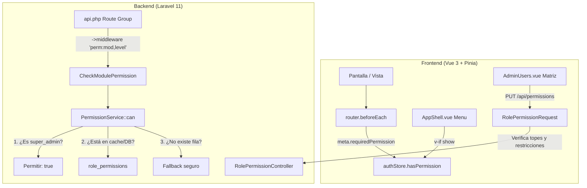

# Plan de Implementación: Matriz Dinámica de Roles y Permisos con Protecciones (Opción C)

> **Documento de especificación y arquitectura técnica**  
> Contexto: [AGENTS.md](../AGENTS.md), [docs/BITACORA.md](BITACORA.md) y [CHANGELOG.md](../CHANGELOG.md).  
> Rama de trabajo: `feat/pos-caja-arranque`.

---

## 1. Objetivo

Conectar la matriz de permisos de la base de datos (`role_permissions`) y su interfaz en **Usuarios → Roles y permisos** al control de acceso real del sistema (backend API, guards de navegación del frontend y menú lateral), garantizando **topes de seguridad inamovibles** y un **mecanismo de fallback seguro** que prevenga brechas de seguridad o bloqueos operativos.

---

## 2. Diagnóstico del Estado Anterior

Antes de esta implementación, existía una desconexión total entre lo que se configuraba visualmente y lo que el sistema ejecutaba:

| Capa | Estado Anterior | Problema / Riesgo |
|---|---|---|
| **Matriz visual** (`AdminUsers.vue`) | Editaba y guardaba registros en la tabla `role_permissions`. | Daba la falsa ilusión al administrador de que estaba otorgando o revocando permisos. |
| **Backend Middlewares** | Tres middlewares rígidos (`EnsureUserIsAdmin`, `EnsureUserIsSuperAdmin`, `EnsureUserHasRole`) leían exclusivamente `user.role`. | Ningún middleware ni consulta en controladores leía la tabla `role_permissions`. |
| **Datos en DB** | 25 filas en `role_permissions` marcaban a `admin` con `read` en todo (incluso catálogo e inventario). | Si se hubiese conectado la tabla directamente sin una estrategia de migración, el admin operativo habría perdido la capacidad de editar productos o registrar compras. |
| **Rol Cocina** | Existía en la base de datos y en el POS, pero no existía en `role_permissions` ni en la interfaz de permisos. | Cocina no podía ser gestionada desde la matriz. |
| **Store Frontend** (`auth.js`) | Recibía `permissions` en las respuestas de `/login` y `/me`, pero los descartaba. | Toda la reactividad de la UI dependía de comparaciones manuales de roles cableadas (`isAdmin`, `isSuperAdmin`, `isKitchen`). |

---

## 3. Opciones Evaluadas

| Opción | Descripción | Pros | Contras | Veredicto |
|---|---|---|---|---|
| **Opción A: Conexión directa** | Conectar `role_permissions` tal cual sin restricciones duras. | Flexibilidad total. | Alto riesgo: un error en la matriz podría permitir a un cajero editar finanzas o bloquear al dueño de su propio sistema. | Descartada |
| **Opción B: Eliminación de la matriz** | Eliminar la pestaña y la tabla `role_permissions`, manteniendo roles fijos en código. | Código simple sin mantenimiento de matriz. | Inflexible: cualquier ajuste de permisos requiere intervención de desarrollo y despliegue. | Descartada |
| **Opción C: Conexión con protecciones (Topes de seguridad)** | La matriz controla el acceso real, pero con topes inamovibles en código y fallback seguro. | **Equilibrio perfecto:** flexibilidad operativa para el dueño, protección contra errores humanos y retrocompatibilidad garantizada. | **Seleccionada y Ejecutada** |

---

## 4. Principios y Topes de Seguridad Inamovibles

Estas reglas están blindadas en el código (backend y frontend) y no pueden ser vulneradas ni modificadas mediante la API:

1. **`super_admin` con edición total incondicional:**
   - Su fila en la matriz es puramente informativa.
   - El servicio de permisos y los middlewares conceden acceso inmediato (`true`) sin necesidad de consultar la base de datos.
   - `RolePermissionRequest` rechaza con error `422` cualquier intento de modificar los permisos de `super_admin`.
2. **Restricciones estrictas para `kitchen` (Cocina):**
   - Módulos prohibidos: `pos`, `register_self`, `register_others`, `users`, `audit`, `reports`, `finance`.
   - Únicamente puede tener acceso de lectura en operaciones de pedidos (`delivery_ops`).
3. **Restricciones estrictas para `cashier` (Cajero):**
   - Módulos prohibidos: `users`, `audit`, `finance`.
   - No puede superar nivel `none` en estos módulos.
4. **Fallback Seguro (Graceful Degradation):**
   - Si una fila `{role, module}` falta en la base de datos (por truncado accidental o migraciones incompletas), el sistema **no deniega todo por error ni abre el sistema**: ejecuta un método de fallback que replica con exactitud los accesos cableados originales.
5. **Doble Llave para Módulos Críticos:**
   - Las rutas de `finance`, `system/backup`, `users` y `audit-logs` conservan el middleware `super_admin` como candado estructural adicional.

---

## 5. Diseño Técnico y Arquitectura



### 5.1 Servicio Central de Permisos (`PermissionService.php`)

Ubicado en `backend/app/Services/PermissionService.php`:
- **Niveles de acceso:** `none` (0) < `read` (1) < `edit` (2).
- **Caché en memoria por request:** almacena las consultas realizadas durante el ciclo de vida de la petición HTTP en `$cache["$role:$module"]` para no saturar SQLite con consultas repetitivas.
- **Constantes de módulos y bloqueos:**
  - `MODULES`: catálogo de los 13 módulos del sistema.
  - `KITCHEN_BLOCKED` y `CASHIER_BLOCKED`: listas canónicas de exclusión.
- **Método `can(User $user, string $module, string $requiredLevel = 'read'): bool`:**
  - Retorna `true` si es `super_admin`.
  - Si existe registro en DB: evalúa si `access_level >= requiredLevel`.
  - Si no existe: invoca `fallback($user, $module, $requiredLevel)`.
- **Método estático `restrictions(): array`:** provee al frontend la lista de módulos bloqueados por rol.

### 5.2 Middleware Parametrizado (`CheckModulePermission.php`)

Ubicado en `backend/app/Http/Middleware/CheckModulePermission.php`:
- Alias registrado en `bootstrap/app.php` como `'perm'`.
- Uso en rutas: `->middleware('perm:catalog,edit')` o `->middleware('perm:pos,read')`.
- En caso de rechazo, devuelve una respuesta JSON limpia (sin trazas HTML):
  ```json
  {
    "success": false,
    "message": "No tienes permiso para acceder a este módulo.",
    "errors": [],
    "code": 403
  }
  ```

### 5.3 Mapeo de Rutas del Sistema (`backend/routes/api.php`)

| Módulo | Nivel Requerido | Rutas API Protegidas |
|---|---|---|
| `catalog` | `edit` | `categories`, `option-groups`, `options`, `products`, `pricing/pedidosya`, `recipes`, `option-recipes` |
| `inventory` | `edit` | `ingredient-categories`, `ingredients`, `inventory/movements`, `inventory/counts`, `inventory/reorder`, `purchases`, `suppliers` |
| `reports` | `read` | `inventory/waste/report` |
| `crm_config` | `edit` | `customers` (escritura), `loyalty-config` |
| `voids` | `edit` | `sales/{sale}/void` (Anulación de ticket de venta) |
| `pos` | `read` / `edit` | `sales/sync`, `sales` (index/show), `admin/sales` (retroactivas) |
| `register_self` | `read` / `edit` | `cash-sessions/*`, `inventory/waste` (mermas anotadas en caja) |
| `delivery_ops` | `read` | `order-queue/*`, `kds/*` (pantalla de comandas móvil y web) |
| `users` | `edit` | `users/*` (con middleware `super_admin`) |
| `audit` | `read` | `audit-logs`, `audit-logs/export` (con middleware `super_admin`) |

### 5.4 Base de Datos y Migración

Migración: `2026_10_15_000001_update_role_permissions_to_match_reality.php`.
Alinea la tabla `role_permissions` con la operación real del negocio:
- **`admin`:** `edit` en catálogo, inventario, mermas/anulaciones, turnos, clientes, delivery y POS; `read` en reportes; `none` en usuarios y auditoría.
- **`cashier`:** `edit` en ventas POS y turno propio (`register_self`); `read` en delivery/comandas y clientes (`crm_read`); `none` en el resto.
- **`kitchen`:** `read` en delivery/comandas (`delivery_ops`); `none` en todo lo demás.

### 5.5 Frontend: Store, Router y UI

1. **Store Pinia (`auth.js`):**
   - Estado `permissions: []` hidratado en `login()` y `fetchUser()`.
   - Método `hasPermission(module, level = 'read')` con lógica idéntica al backend:
     - Retorna `true` si el usuario es `super_admin`.
     - Evalúa si el nivel guardado cumple con el requerido.
     - Aplica fallback local si aún no se han cargado los permisos.
2. **Router Guards (`router/index.js`):**
   - Cada ruta declara su permiso requerido en `meta.requiredPermission`.
   - `router.beforeEach` intercepta intentos de acceso no autorizado y redirige al usuario a su pantalla natural (`/delivery` para cocina, `/pos` para cajeros, `/turno` según corresponda).
3. **Menú Lateral (`AppShell.vue`):**
   - Los enlaces de navegación (Vender, Caja, Menú, Inventario, Control Diario, etc.) condicionan su atributo `show` con `auth.hasPermission(module, 'read')`.
4. **Pantalla de Administración (`AdminUsers.vue`):**
   - Se añadió la columna **Cocina** (`kitchen`).
   - Celdas bloqueadas identificadas visualmente con icono de candado (`.oh-perm-blocked`) y deshabilitadas para impedir errores de configuración.
   - Botón "Restaurar borrador" con confirmación para recargar la configuración real desde el backend.
   - Persistencia reactiva que sincroniza inmediatamente los permisos del usuario activo.

---

## 6. Verificación y Cobertura de Pruebas

### 6.1 Tests Unitarios y de Integración (`PermissionServiceTest.php`)
Se implementó una batería de 8 tests automatizados en `backend/tests/Feature/PermissionServiceTest.php`:
1. `test_super_admin_always_has_access_to_all_modules_and_levels`: Acceso total para Super Admin.
2. `test_fallback_behavior_when_table_has_no_entry`: Comportamiento de contingencia ante tabla vacía.
3. `test_dynamic_permission_overrides_fallback`: La matriz en base de datos tiene precedencia efectiva.
4. `test_middleware_blocks_access_when_permission_missing`: Retorno de HTTP 403 ante permisos denegados.
5. `test_super_admin_can_update_permissions_matrix`: Guardado en lote por parte de Super Admin.
6. `test_cannot_update_super_admin_permissions`: Validación 422 si se intenta modificar Super Admin.
7. `test_cannot_give_blocked_modules_to_kitchen_or_cashier`: Validación 422 ante módulos prohibidos.
8. `test_permissions_index_returns_permissions_modules_and_restrictions`: Contrato JSON enriquecido.

### 6.2 Resultados de la Verificación
- **Backend:** `330/330` tests aprobados (`php artisan test`, 1.819 aserciones).
- **Frontend:** `npx vite build` completado exitosamente sin errores de compilación ni advertencias de sintaxis.
- **Auditoría de Grafo:** `graphify update .` ejecutado, sincronizando 3.714 nodos y 7.253 aristas.

---

## 7. Mapa de Archivos Afectados

```
backend/
├── app/
│   ├── Http/
│   │   ├── Controllers/
│   │   │   └── RolePermissionController.php        [Modificado - expone restrictions y módulos]
│   │   ├── Middleware/
│   │   │   └── CheckModulePermission.php          [Nuevo - middleware 'perm']
│   │   ├── Requests/
│   │   │   └── RolePermissionRequest.php          [Modificado - valida topes de seguridad]
│   │   └── Resources/
│   │       └── UserResource.php                   [Modificado - expone ci, phone, start_date]
│   └── Services/
│       └── PermissionService.php                  [Nuevo - servicio central con fallback]
├── bootstrap/
│   └── app.php                                    [Modificado - registra alias 'perm']
├── database/
│   └── migrations/
│       └── 2026_10_15_000001_update_role_...php   [Nuevo - sincronización de datos]
├── routes/
│   └── api.php                                    [Modificado - rutas protegidas con perm]
└── tests/Feature/
    └── PermissionServiceTest.php                  [Nuevo - 8 tests de integración]

frontend/
├── src/
│   ├── components/
│   │   └── AppShell.vue                           [Modificado - menú lateral dinámico]
│   ├── router/
│   │   └── index.js                               [Modificado - guard de rutas con permisos]
│   ├── stores/
│   │   └── auth.js                                [Modificado - hasPermission reactivo]
│   └── views/
│       └── AdminUsers.vue                         [Modificado - columna cocina y celdas lock]

docs/
├── BITACORA.md                                    [Modificado - registro de sesión 2026-10-15]
├── CHANGELOG.md                                   [Modificado - notas en Sin publicar]
└── PLAN_ROLES_PERMISOS.md                         [Nuevo - documento de este plan]
```
