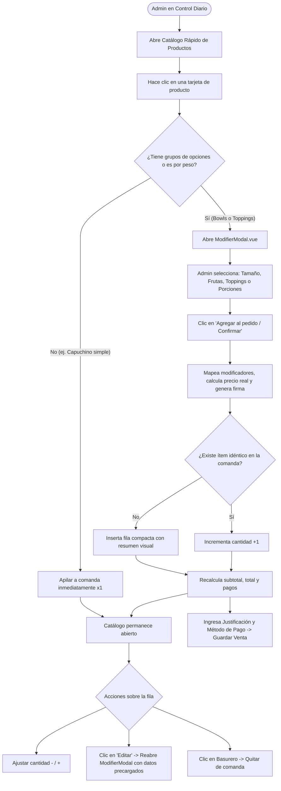

# Plan Integral: Flujo Unificado de Comandas Multi-Ítem, Selección de Opciones y Toppings en Control Diario

> **Módulos afectados:** [AdminSaleEditor.vue](../frontend/src/components/AdminSaleEditor.vue), [RetroactiveSales.vue](../frontend/src/views/RetroactiveSales.vue), [ModifierModal.vue](../frontend/src/components/ModifierModal.vue), [Turno.vue](../frontend/src/views/Turno.vue), [Pos.vue](../frontend/src/views/Pos.vue).  
> **Reglas y lineamientos:** [AGENTS.md](../AGENTS.md) y [.agents/rules/buenas-practicas.md](../.agents/rules/buenas-practicas.md).  
> **Rama sugerida:** `feat/control-diario-flujo-opciones-toppings`.  
> **Estado:** Documento de especificación y arquitectura técnica completa para revisión y aprobación.

---

## 1. Contexto Operativo y Necesidad del Negocio

En la operación real de **Ohana Açaí**, existen dos escenarios habituales de registro de comandas:

1. **Venta directa en mostrador (POS en vivo - `Pos.vue`):**
   - El cajero atiende al cliente en tiempo real.
   - Toca un producto como **Classic Bowl** o **Arma tu Bowl**: el sistema abre inmediatamente el configurador visual ([ModifierModal.vue](../frontend/src/components/ModifierModal.vue)).
   - El cajero selecciona de forma guiada el **Tamaño** (*Junior base Bs 28.00, Mediano +Bs 7.00, Grande +Bs 14.00, Ohana +Bs 32.00*), las **Frutas** (hasta 3), los **Toppings** (hasta 10) y las salsas.
   - Al pulsar *«Agregar al pedido»*, el ítem entra al ticket con su precio real y opciones desglosadas.

2. **Registro diferido o fuera de fecha (Control Diario y Arqueo - `RetroactiveSales.vue` / `AdminSaleEditor.vue`):**
   - Se utiliza para digitalizar ventas acumuladas por cortes de energía, contingencia con talonario manual o corrección de turnos pasados.
   - Una comanda de talonario físico típicamente contiene **múltiples ítems combinados** (ejemplo: *1 Hawaiian Bowl Mediano con frutilla y granola* + *1 porción de Chubi* + *1 porción de Chips de Chocolate* + *1 Capuchino*).
   - **Problema actual reportado:** Al hacer clic en un Bowl o en el producto de Toppings en Control Diario, **el sistema no abre el modal de opciones**; en su lugar, inserta directamente el producto con precio base (Bs 28.00 para Bowls, o Bs 0.00 para Toppings) en una fila colapsada. El administrador se ve obligado a conformarse con ese precio o a desplegar un acordeón tosco de checkboxes para reconstruir las opciones manualmente.

---

## 2. Comparativa Técnica Exhaustiva: Sistema Local vs. Producción

Para tener certeza absoluta del estado del software antes de intervenir:

| Componente / Capa | Entorno Local (Mac de Desarrollo) | Entorno de Producción (Laptop Windows de Caja) |
| :--- | :--- | :--- |
| **Código Fuente (Git)** | Rama `main` en commit `3fa5b0b`. Sincronizado con `origin/main`. | Rama `main` en commit `3fa5b0b` (actualizado automáticamente por el vigilante `vigilante-actualizaciones.ps1`). |
| **Migraciones de BD** | **2 migraciones pendientes:**<br>1. `2026_10_15_000001_update_role_permissions_to_match_reality`<br>2. `2026_10_16_000001_normalize_role_permission_levels` | **Migraciones al día:**<br>El script `actualizar-pos.bat` corre `php artisan migrate --force` en cada sincronización. |
| **Solución de Toppings** | **Ya creada en BD:**<br>• Categoría «Toppings» (ID 11).<br>• Producto «Toppings» (ID 33, Base Bs 0.00).<br>• Vinculado a `option_group_id` 4 (Toppings a +Bs 4.00 c/u con recetas de inventario). | Idéntica configuración en BD mediante el módulo de Menú. |
| **Comportamiento en POS (`Pos.vue`)** | Funciona 100%: Clic en «Toppings» abre `ModifierModal.vue`, permite marcar los extras deseados (+Bs 4.00 c/u) y los suma al ticket con su subtotal correcto. | Funciona 100% igual que en local. |
| **Comportamiento en Control Diario (`AdminSaleEditor.vue`)** | **Incompleto:** Al hacer clic en Bowls o Toppings, no se abre el modal. Se agregan a ciegas con opciones vacías / base colapsadas. | **Incompleto:** Mismo comportamiento que en local. |

> [!NOTE]
> **Conclusión sobre datos de backend:**
> La solución creada por el usuario (Producto «Toppings» con precio base Bs 0.00 y grupo de opciones a Bs 4.00) es nativa, funciona a la perfección en el POS y deduce inventario automáticamente.
> **Por tanto, se descarta definitivamente del plan la creación manual de 13 productos independientes en el backend y el comando `catalog:sync-toppings`**, evitando ensuciar el catálogo o alterar recetas consolidadas.

---

## 3. Diagnóstico del Problema en Control Diario

En [AdminSaleEditor.vue](../frontend/src/components/AdminSaleEditor.vue), la función `addProductToSale(product)` opera actualmente así:

```javascript
// CÓDIGO ACTUAL EN AdminSaleEditor.vue
function addProductToSale(product) {
  const groups = getProductOptionGroups(product);
  const selectedOptionIds = {};

  // Inicializa opciones por defecto (vacías para frutas y tamaños)
  groups.forEach(og => { ... });

  const newItem = {
    product_id: product.id,
    quantity: 1,
    unit_price: initialBasePrice, // Bs 28.00 para Bowls, Bs 0.00 para Toppings
    subtotal: initialBasePrice,
    selectedOptionIds,
    ...
  };

  // Solo se expande si un grupo tiene min_selections > 0 (Tamaño Acai tiene min_selections = 0)
  newItem.isExpanded = groups.some(og => (og.min_selections || 0) > (selectedOptionIds[og.id] || []).length);
  formData.value.items.push(newItem);
}
```

### Causas identificadas:
1. **Falta de invocación del configurador:** `addProductToSale()` nunca llama a un modal.
2. **Evaluación de obligatoriedad:** El grupo de opciones `"Tamaño Acai"` tiene configurado `min_selections: 0` y `max_selections: 1`. Por eso, el sistema no detecta que falta elegir tamaño y asume que el producto es un Junior base sin extras.
3. **Producto «Toppings» a Bs 0.00:** Al no tener seleccionada ninguna opción, el precio unitario queda en Bs 0.00 y no se le pide al usuario que indique si el cliente compró gomitas, chubi o chispas.
4. **Experiencia tosca:** Para configurar un bowl, el usuario debe buscar la pequeña flecha `[ v ]`, expandir la fila y marcar checkboxes en un formulario vertical de 500 px de alto, en lugar de la experiencia visual y fluida que ya tiene la caja.

---

## 4. Arquitectura de la Solución: Flujo Unificado con `ModifierModal`

El objetivo es reutilizar el componente existente [ModifierModal.vue](../frontend/src/components/ModifierModal.vue) dentro de [AdminSaleEditor.vue](../frontend/src/components/AdminSaleEditor.vue) para lograr **paridad total** entre la venta en caja y el registro de ventas fuera de fecha.

### Diagrama de Flujo



---

## 5. Especificación Técnica de Implementación

### 5.1 Integración de Componentes (`AdminSaleEditor.vue`)
Importar [ModifierModal.vue](../frontend/src/components/ModifierModal.vue) y declarar la reactividad requerida:

```javascript
import ModifierModal from './ModifierModal.vue';

// Estados para el configurador de opciones
const showModifierModal = ref(false);
const selectedProductForModal = ref(null);
const editingItemIndex = ref(null); // null = nuevo ítem; número = editando fila existente
const modalInitialData = ref(null);
```

### 5.2 Interceptación en `addProductToSale(product)`
```javascript
function addProductToSale(product) {
  const groups = getProductOptionGroups(product);
  const hasOptions = groups && groups.length > 0;
  const isWeight = Boolean(product.is_weight_based);

  if (hasOptions || isWeight) {
    // Abrir configurador idéntico al POS
    selectedProductForModal.value = product;
    editingItemIndex.value = null;
    modalInitialData.value = null;
    showModifierModal.value = true;
  } else {
    // Producto simple: apilado continuo con 1 clic
    appendSimpleProduct(product);
  }
}
```

### 5.3 Procesamiento de la Confirmación (`handleConfirmModal`)
Al confirmar desde el `ModifierModal`:
```javascript
function handleConfirmModal({ product, modifiers, finalPrice, itemNote, allergenFlags, isTakeaway, weightGrams }) {
  showModifierModal.value = false;

  // Reconstruir selectedOptionIds por grupo a partir de modifiers para compatibilidad
  const groups = getProductOptionGroups(product);
  const selectedOptionIds = {};
  groups.forEach(og => {
    selectedOptionIds[og.id] = (modifiers || [])
      .filter(m => og.options.some(o => o.id === m.option_id))
      .map(m => m.option_id);
  });

  const isWeight = Boolean(product.is_weight_based);
  const itemData = {
    product_id: product.id,
    quantity: isWeight ? 1 : 1,
    priceMode: isWeight ? 'weight' : 'auto',
    weightGrams: isWeight ? Number(weightGrams) : 0,
    pricePerGram: Number(product.price_per_gram || 0.08),
    unit_price: Number(finalPrice),
    subtotal: Number(finalPrice),
    is_takeaway: isTakeaway || formData.value.is_takeaway,
    item_note: itemNote || '',
    priceOverrideReason: '',
    selectedOptionIds,
    modifiers: modifiers || [],
    isExpanded: false // Se mantiene compacta porque ya fue configurada
  };

  if (editingItemIndex.value !== null) {
    // MODO EDICIÓN: actualiza la fila existente preservando la cantidad actual
    const currentQty = formData.value.items[editingItemIndex.value].quantity || 1;
    itemData.quantity = currentQty;
    itemData.subtotal = Number((currentQty * itemData.unit_price).toFixed(2));
    formData.value.items[editingItemIndex.value] = itemData;
  } else {
    // MODO CREACIÓN: verifica si ya existe uno igual para solo subir cantidad
    const sig = itemSignature(itemData);
    const existing = !isWeight ? formData.value.items.find(it => itemSignature(it) === sig) : null;
    if (existing) {
      existing.quantity = Number(existing.quantity || 0) + 1;
      existing.subtotal = Number((existing.quantity * existing.unit_price).toFixed(2));
    } else {
      formData.value.items.push(itemData);
    }
  }

  autoSyncPayments();
  selectedProductForModal.value = null;
  editingItemIndex.value = null;
}
```

### 5.4 Re-edición de Ítems desde la Comanda
En la lista de ítems de la comanda:
- Cada ítem muestra un botón `[✏ Editar]` o `[⚙ Modificar]`.
- Al pulsarlo, se prepara `modalInitialData`:
  ```javascript
  function openEditItemModal(index) {
    const item = formData.value.items[index];
    const product = getProduct(item.product_id);
    if (!product) return;

    selectedProductForModal.value = product;
    editingItemIndex.value = index;
    modalInitialData.value = {
      cartKey: `admin_item_${index}`,
      modifiers: item.modifiers || [],
      itemNote: item.item_note || '',
      allergenFlags: [],
      isTakeaway: item.is_takeaway || false,
      weightGrams: item.weightGrams || 350
    };
    showModifierModal.value = true;
  }
  ```

### 5.5 Visualización de la Fila Compacta en la Comanda
Cada ítem en la comanda mostrará:
- **Encabezado:** `#1 Hawaiian Bowl` o `#2 Toppings`.
- **Resumen:** Texto legible con los modificadores aplicados (ej: *«Tamaño: Mediano (+Bs 7.00) · Fruta: Frutilla, Plátano · Toppings: Granola, Leche en polvo»* o *«Chips de Chocolate (+Bs 4.00), Ositos de gomita (+Bs 4.00)»*).
- **Precio Unitario y Subtotal:** Claramente visibles.
- **Acciones:**
  - Stepper: `[ − ]` `[ 1 ]` `[ ＋ ]`.
  - Botón: `[✏ Editar]` para reabrir el modal.
  - Botón: `[🗑]` para remover.

---

## 6. Fases y Tareas de Ejecución

### Fase 1: Creación de Rama de Trabajo
* Crear rama aislada `feat/control-diario-flujo-opciones-toppings` desde `main`.

### Fase 2: Implementación en `AdminSaleEditor.vue`
1. Integrar el componente `<ModifierModal>` en el template de `AdminSaleEditor.vue`.
2. Conectar el canal dinámico (`channel="saleOrigin === 'pedidosya' ? 'pedidosya' : 'pos'"`).
3. Modificar `addProductToSale()` para abrir el modal en productos con opciones o peso.
4. Implementar `handleConfirmModal()` con recálculo de precios, modificadores y subtotales.
5. Añadir botón y manejador `openEditItemModal()` en las filas de comanda.
6. Garantizar que el selector rápido de catálogo permanezca visible y utilizable para apilar más ítems.

### Fase 3: Pruebas Funcionales y de Integración
1. **Prueba A (Venta de Bowl configurado):**
   - Clic en *Classic Bowl* $\to$ abre modal $\to$ seleccionar *Mediano* (+Bs 7.00) + Frutilla + Granola $\to$ confirmar $\to$ verificar que entre a comanda a **Bs 35.00** con resumen visible.
   - Probar botón `[Editar]` $\to$ cambiar a *Grande* (+Bs 14.00) $\to$ verificar que actualice a **Bs 42.00**.
2. **Prueba B (Venta de Toppings sueltos):**
   - Clic en *Toppings* $\to$ abre modal $\to$ marcar *Chips de Chocolate* (+Bs 4.00) y *Chubi* (+Bs 4.00) $\to$ confirmar $\to$ verificar que entre a comanda a **Bs 8.00**.
   - Presionar `[＋]` en el stepper $\to$ verificar que suba a cantidad 2 (Total **Bs 16.00**).
3. **Prueba C (Guardado Retroactivo y Arqueo):**
   - Completar comanda mixta (Bowl + Toppings), ingresar Justificación de auditoría, seleccionar método Efectivo y presionar *«Registrar Venta Retroactiva»*.
   - Verificar que la venta se registre en base de datos con sus registros en `sale_item_options`.
   - Verificar que el panel lateral de Arqueo de Caja del día sume el efectivo exacto.

### Fase 4: Verificación Obligatoria de Calidad
* Backend: `cd backend && php artisan test` (todos los tests en verde).
* Frontend: `cd frontend && npx vite build` (build sin errores).
* Suite E2E: Actualizar y correr `frontend/e2e/control-diario-apilado.spec.js`.
* Contraste y Accesibilidad: `scripts/audit-contrast.cjs`.
* Sincronización de Graphify: `graphify update .`.
* Actualización de [docs/BITACORA.md](BITACORA.md) y [CHANGELOG.md](../CHANGELOG.md).

---

## 7. Criterios de Aceptación

1. **Paridad de experiencia:** Configurar un Bowl o Toppings en Control Diario es idéntico visual y funcionalmente al POS de caja.
2. **Cero ítems a Bs 0.00 accidentales:** El producto «Toppings» nunca se añade vacío sin pasar por la selección de extras.
3. **Precios transparentes:** Los Bowls reflejan fielmente el precio del tamaño elegido (Junior Bs 28, Mediano Bs 35, Grande Bs 42, Ohana Bs 60).
4. **Agilidad en comandas multi-ítem:** El catálogo no se cierra automáticamente; permite armar comandas completas de talonario con múltiples productos sin recargar ni perder el contexto.
5. **Trazabilidad e Inventario:** Las ventas guardadas descuentan los ingredientes correspondientes mediante las recetas asociadas a cada opción.
